# PaySure — UPI Payment Reliability Lab

> **Sandbox — Simulated Payments.** PaySure never connects to NPCI, a bank or any real payment
> network, never asks for a real UPI PIN, and never moves real money.

PaySure is a UPI-inspired payment simulator built to show how a payment platform stays **correct when things go wrong**:
banks time out, acknowledgements are lost, callbacks arrive twice or out of order, webhooks fail, Redis disappears and
clients retry. Its centrepiece is a **Reliability Lab** where you inject those faults into a simulated bank and watch
idempotency, reserved funds and self-healing reconciliation recover the system **without a double debit**.

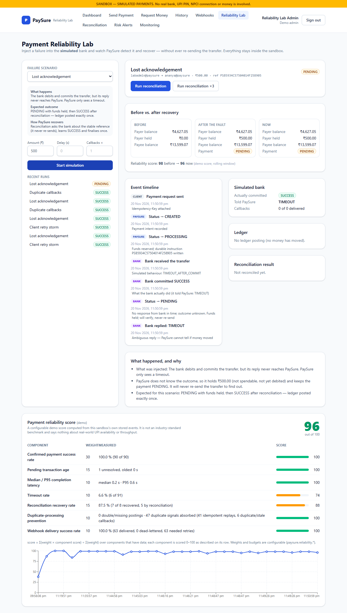

## The business problem

In payments the hardest bug is not "the request failed" but **"we don't know whether it succeeded"**. A system that treats a
bank timeout as a failure and retries can debit a customer twice; one that treats it as success can lose money. A customer
sees "payment failed" while the bank has in fact debited them. PaySure models the correct behaviour: mark the payment
**PENDING**, hold the funds, ask the bank about the *same stable reference* (never re-send), and finalise **exactly once** —
and it makes every step observable. Read the plain-language guide:
**[Why a Payment Can Be Pending Even When Money Was Debited](docs/why-pending.md)**.

## What it demonstrates

| Guarantee | How |
|---|---|
| Money is never created, lost or double-spent | Integral paise; double-entry append-only ledger; DB constraint triggers; `UNIQUE (journal_type, reference_id)` |
| A retry never pays twice | `Idempotency-Key` claimed with `INSERT … ON CONFLICT DO NOTHING` in the payment's own transaction |
| Unknown outcomes are not guessed | `PENDING` + reserved funds + status verification by stable bank reference |
| Recovery is automatic and safe | Reconciliation worker with leases and `SKIP LOCKED`; query-only; unknown stays pending; escalation |
| Events are not lost or invented | Transactional outbox → Kafka → idempotent inbox consumers |
| Integrations are safe | HMAC-signed webhooks, replay window, backoff + jitter, dead letters, SSRF guard |
| Dependencies may fail | Redis rate limiting and status cache degrade to in-memory / PostgreSQL |
| Behaviour is explainable | Reliability score formula, risk-rule explanations, Lab timeline "what happened, and why" |

## Screenshots

Captured from the running app by `frontend/e2e/screenshots.spec.ts` (the numbers reflect test traffic on a development database).

| | |
|---|---|
| 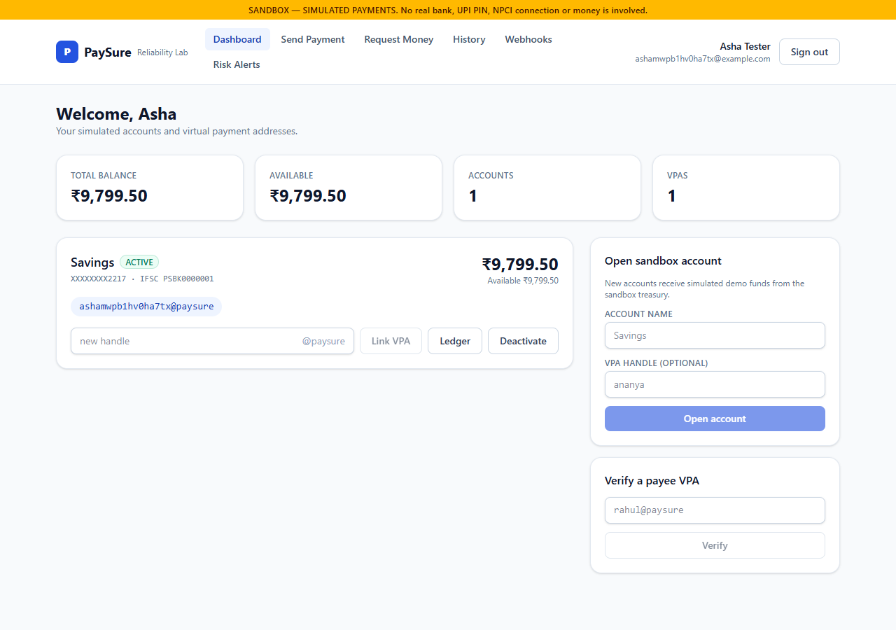 **Dashboard** — balance and sandbox accounts | 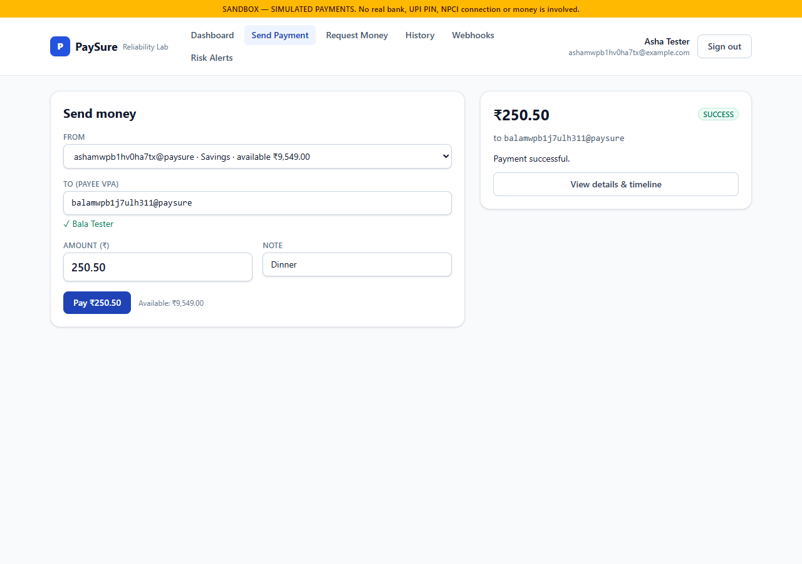 **Send money** — payee verified by name, idempotency key shown |
| 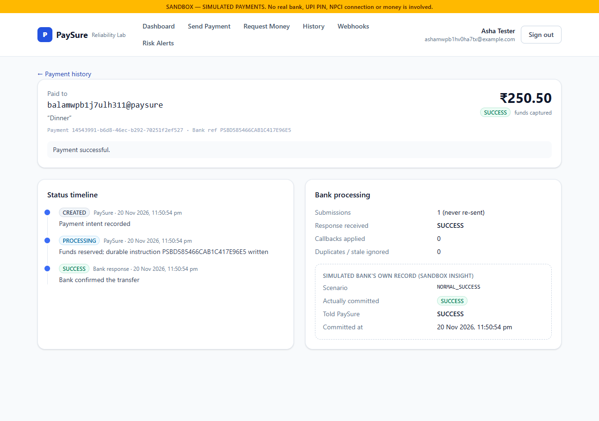 **Payment detail** — status timeline and bank processing | 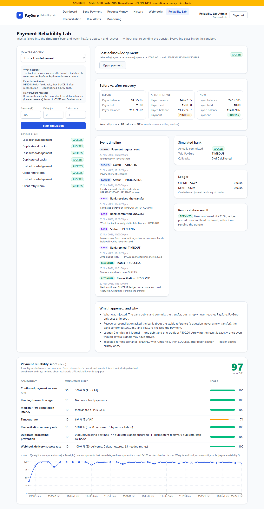 **Lab, after reconciliation** — PENDING → SUCCESS, one debit and one credit |
| 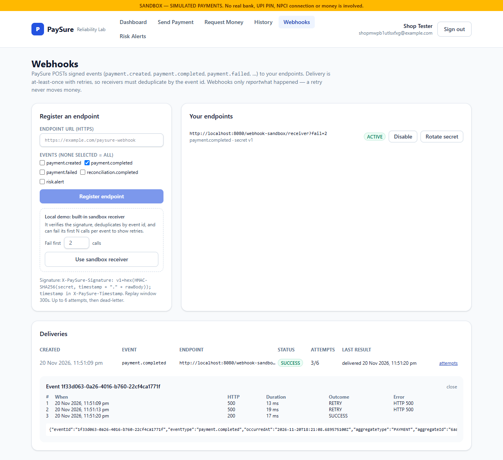 **Webhooks** — attempts 500, 500, 200 and delivered | 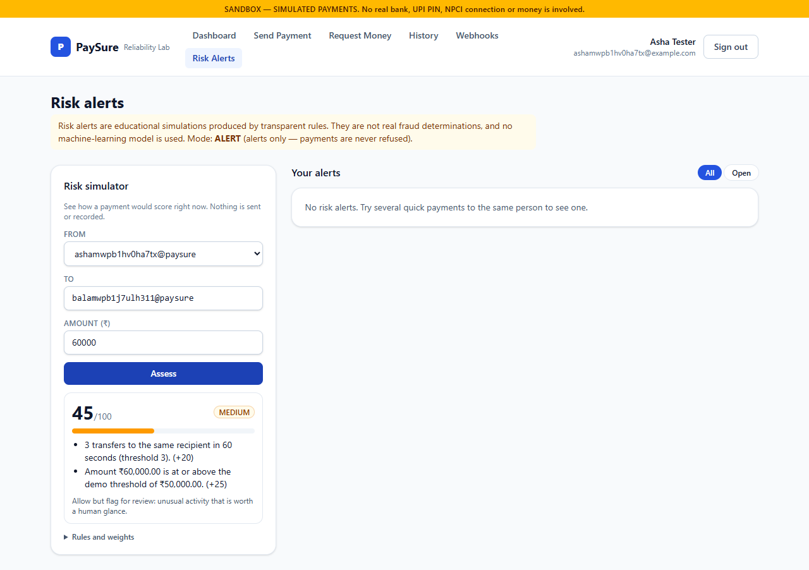 **Risk simulator** — every point of the score explained |

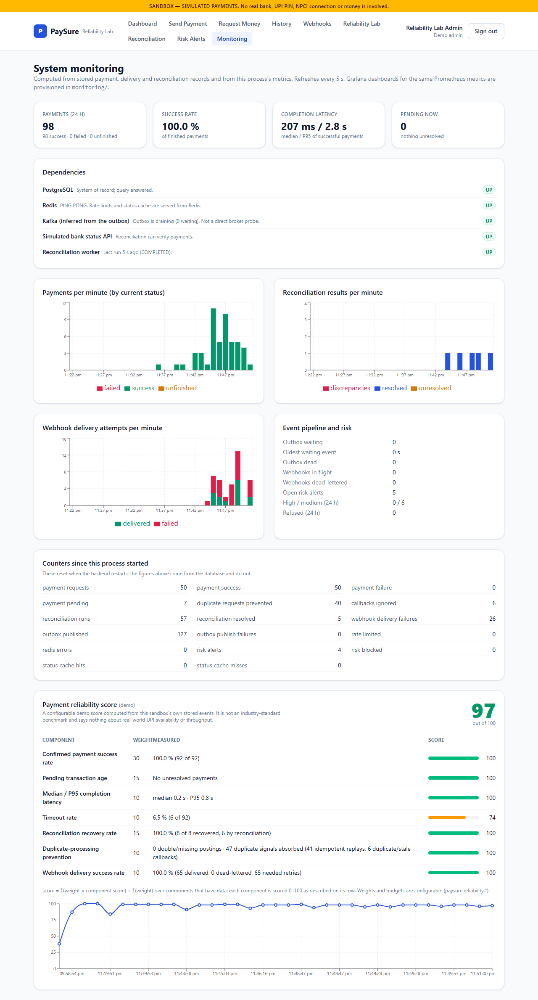

## Architecture

A modular monolith ([docs/architecture.md](docs/architecture.md)) with PostgreSQL as the single system of record.

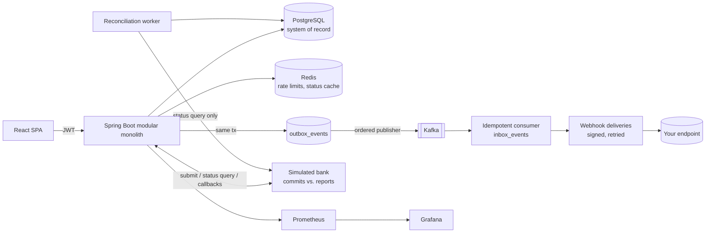

| Layer | Technology |
|---|---|
| Backend | Java 17, Spring Boot 3.5, Spring Security (JWT resource server), Data JPA + JDBC, Flyway, PostgreSQL 17, Apache Kafka, Redis (Lettuce), Micrometer/Prometheus, springdoc OpenAPI |
| Frontend | React 19, TypeScript, Vite 8, Tailwind CSS 4, React Router 7, Recharts |
| Tests | JUnit 5, Spring Boot Test, Testcontainers (PostgreSQL, Redis) / embedded PostgreSQL + in-process Kafka + real `redis-server` without Docker, Vitest + React Testing Library, Playwright |
| Ops | Docker, Docker Compose (PostgreSQL, Redis, Kafka KRaft, backend, nginx frontend, Prometheus, Grafana), GitHub Actions |

### Database design

Money is `BIGINT` paise everywhere. Core tables: `users`, `accounts`, `vpas`, `ledger_journals` / `ledger_entries` (immutable),
`payments`, `payment_attempts`, `payment_state_history`, `idempotency_keys`, `bank_*` (simulator), `reconciliation_*`,
`lab_runs`, `outbox_events`, `inbox_events`, `webhook_*`, `risk_alerts`. Full schema, constraints and triggers:
[docs/database.md](docs/database.md) · design rationale: [ADR 0001](docs/adr/0001-ledger-and-reserved-funds.md).

## Payment state machine

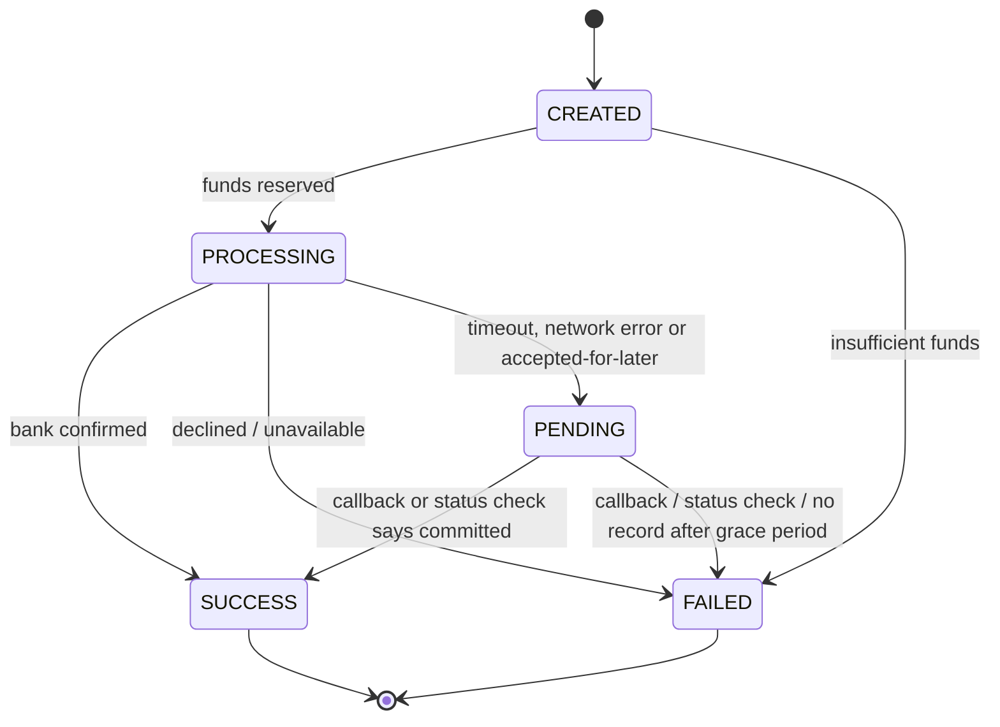

`SUCCESS` and `FAILED` have **no exits**; the machine is defined in one place and every transition is appended to an append-only history.

## Transaction processing flow

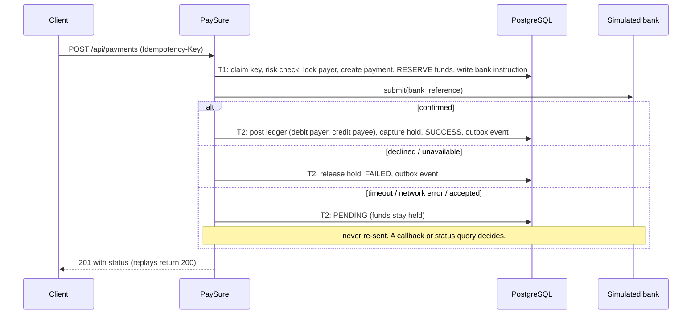

Step-by-step with the lock order: [docs/payments.md](docs/payments.md).

## Idempotency

`POST /api/payments` **requires** an `Idempotency-Key`. The key is claimed inside the same transaction that creates the payment, so
exactly one request wins a race and the others return the winner's result.

| Situation | Result |
|---|---|
| Same key, same body | `200` and `Idempotent-Replayed: true`; the original payment, nothing charged again |
| Same key, different body | `409` conflict (canonical SHA-256 request hash) |
| 10 identical concurrent requests | 1 payment, 1 bank instruction, 1 ledger transfer (1×`201`, 9×`200`) — acceptance check **B** |
| Browser loses the response | The UI keeps the key and offers **Retry safely**, which reuses it (Playwright test) |

Rationale: [ADR 0003](docs/adr/0003-idempotency-claim-before-reserve.md).

## Failure recovery logic

| What went wrong | What PaySure does | Outcome |
|---|---|---|
| Bank commits but the reply is lost | `PENDING`, funds held, no ledger posting; reconciliation asks the bank about the stable reference | `SUCCESS`, exactly one debit and credit |
| Bank timed out and never committed | `PENDING` → status check says no record (after a grace period) | `FAILED`, hold released |
| Status API is down | Reconciliation reports `UNKNOWN` and **leaves it PENDING** — it never guesses | Resolves when the API returns |
| Still processing at the bank | Left pending, then escalated to manual review after N attempts / age | Human decision; never auto-fixed |
| Duplicate / out-of-order callback | Sequence numbers + state machine + one ledger transfer per payment | Applied once, extras ignored |
| Two workers reconcile at once | Leases + `FOR UPDATE SKIP LOCKED` | One worker per payment |
| Kafka is down | Outbox rows wait in PostgreSQL | Events delayed, payments unaffected |
| Webhook endpoint fails | Equal-jitter exponential backoff, up to 6 attempts, then `DEAD` + manual retry | Delivered once at business level |
| Redis is down | In-memory rate limiting, status reads from PostgreSQL | Payments keep working |

Details: [docs/reconciliation.md](docs/reconciliation.md) · [docs/events.md](docs/events.md) · [docs/webhooks.md](docs/webhooks.md) · [docs/redis.md](docs/redis.md).

## Features

- **Foundations** — integral paise; double-entry append-only ledger re-checked by a deferred DB constraint trigger; no overdrafts or lost updates
  (row locks in deterministic order, refreshed under the lock); globally unique VPAs; server-side authorization from a verified JWT; RFC 7807 errors.
  There is **no API that sets a balance**: demo funds come from a SYSTEM treasury through the ledger.
- **Payments** — reserved funds before the bank is called; deterministic simulated bank (10 scenarios) that records what it *committed* separately from
  what it *told* PaySure; collect (request-money) with exactly-once approval; status check by stable reference.
- **Reliability Lab** (demo admin) — 13 fault scenarios; timeline with CLIENT / PAYSURE / BANK / RECONCILER actors; before-vs-after balances; ledger;
  generated explanation. An **explainable reliability score** from stored events with a published formula (a demo score, not an industry benchmark).
- **Events** — transactional outbox, ordered publisher, Kafka (`acks=all`, idempotent producer), inbox-deduplicating consumers, `<topic>.DLT`
  ([ADR 0002](docs/adr/0002-transactional-outbox.md)).
- **Webhooks** — `HMAC-SHA256(timestamp.rawBody)`, replay window, attempt log, backoff + jitter, dead letters + manual retry, SSRF guard at registration
  *and* delivery, derived (never stored) secrets with rotation, built-in sandbox receiver that processes each event once.
- **Redis** — atomic Lua rate limiting (payments per user/IP, collect, auth) and a read-through status cache invalidated after commit.
- **Risk engine** — six transparent rules, score 0–100 with explanation, ALERT by default (never blocks), optional ENFORCE
  ([ADR 0004](docs/adr/0004-risk-engine-alert-by-default.md), [docs/risk.md](docs/risk.md)). An educational simulation, no ML.
- **Monitoring** — in-app monitoring page (real DB figures, honest dependency probes, charts), Prometheus + provisioned 16-panel Grafana dashboard
  ([docs/monitoring.md](docs/monitoring.md)).

## Running it

### Option A — Docker Compose (whole stack)

```bash
cp .env.example .env          # then set PAYSURE_JWT_SECRET (openssl rand -base64 48), POSTGRES_PASSWORD, GRAFANA_ADMIN_PASSWORD
docker compose up --build
```

```powershell
Copy-Item .env.example .env
docker compose up --build
```

- App: <http://localhost:3000> · API: <http://localhost:8080> · Swagger UI: <http://localhost:8080/swagger-ui.html>
- Grafana: <http://localhost:3001> (user `admin`, password `GRAFANA_ADMIN_PASSWORD`) · Prometheus: <http://localhost:9090>
- Health: <http://localhost:8080/actuator/health> · metrics: <http://localhost:8080/actuator/prometheus>

> **Status of this path:** the Compose file, images and CI job were written and statically validated but **not run on the development machine
> (no Docker available there)**. Running `docker compose up --build` and the CI `e2e` job is the first time they execute. Report anything that breaks.

### Option B — no Docker (backend on embedded PostgreSQL, Kafka and Redis)

Requires JDK 17+ and Node 20+.

```bash
cd backend && ./mvnw spring-boot:test-run      # Windows: .\mvnw.cmd spring-boot:test-run
cd frontend && npm install && npm run dev      # http://localhost:5173 (proxies /api to :8080)
```

`spring-boot:test-run` starts a real PostgreSQL 17 from Maven-provided binaries, an in-process Kafka broker and a real `redis-server`, and runs the
`dev` profile (demo users seeded, dev tools and the sandbox webhook receiver on).

### Demo users (seeded when `PAYSURE_SEED_ENABLED=true`)

| E-mail | Role | VPA | Opening balance |
|---|---|---|---|
| `ananya@example.com` | USER | `ananya@paysure` | ₹10,000.00 |
| `rahul@example.com` | USER | `rahul@paysure` | ₹10,000.00 |
| `merchant@example.com` | USER | `teastall@paysure` | ₹10,000.00 |
| `labadmin@example.com` | ADMIN_DEMO | `labadmin@paysure` | ₹10,000.00 |

Password: `PAYSURE_DEMO_PASSWORD` (`.env.example` and the `dev` profile use `Sandbox@123`). Sandbox-only credentials.

## Demonstration (2 minutes)

1. Sign in as `labadmin@example.com` → **Reliability Lab** → **Lost acknowledgement** → **Start simulation**.
2. Result: **PENDING**, ₹500 *held* (not debited), no ledger posting. The bank's record says *committed: SUCCESS, told PaySure: TIMEOUT*.
3. **Run reconciliation** (or wait ≈ 15–25 s for the worker): it asks the bank about the reference; the payment becomes **SUCCESS** with exactly one
   debit and one credit. Run it again: nothing changes.
4. **Webhooks** → *Use sandbox receiver* (fail first 2) → *Register endpoint*, then pay that user: the delivery goes RETRYING (HTTP 500) twice, then
   SUCCESS; the operator panel shows the event was **processed once** in 3 calls.
5. Try **Lost ack + status API outage**, **Stuck at the bank**, **Client retry storm** (10 requests → 1 payment), **Duplicate callbacks**.

Prefer a script? `python scripts/acceptance_demo.py` runs acceptance checks A–H against a running backend and prints PASS/FAIL for each.
`sh scripts/smoke-test.sh` / `.\scripts\smoke-test.ps1` is a shorter smoke test. API examples: [docs/api-examples.md](docs/api-examples.md).

## Testing

```bash
cd backend && ./mvnw verify                                   # real PostgreSQL (Testcontainers if Docker exists, else embedded)
cd backend && ./mvnw verify -Dpaysure.test.db=testcontainers  # force containers (what CI does)
cd frontend && npm run lint && npm test && npm run build
cd frontend && E2E_CHANNEL=msedge npm run e2e                 # Playwright; starts the backend and Vite itself (see docs/testing.md)
python scripts/acceptance_demo.py                             # against a running backend
```

Tests assert **money invariants in SQL** — every journal nets to zero, balances equal net ledger movement, nothing below zero, reserved funds
equal held payments, one ledger transfer per SUCCESS payment — not just HTTP codes. The mapping of all **25 mandatory cases** to test methods, what
runs against which real infrastructure, and the honest list of gaps is in **[docs/testing.md](docs/testing.md)**. Recorded results of each run:
[docs/progress.md](docs/progress.md).

## Security notes and limitations

- Sandbox only. No real credentials of any kind are accepted or stored; never reuse a real password.
- JWTs are HS256 with a shared secret (`PAYSURE_JWT_SECRET`, ≥ 32 bytes, enforced at startup); no refresh tokens or server-side revocation. Tokens live in `sessionStorage`.
- `/actuator/prometheus` is unauthenticated for local scraping; restrict it at the network layer outside a demo. Set `GRAFANA_ADMIN_PASSWORD` yourself.
- Risk alerts are educational simulations from transparent rules, not fraud determinations. The default mode never blocks.
- Rate limits are fixed windows (up to 2× burst across a boundary). Per-IP limits trust `X-Forwarded-For` only when `PAYSURE_RATE_LIMIT_TRUST_XFF=true`.
- Webhook SSRF protection narrows but does not eliminate DNS-rebinding races. The sandbox receiver and the `localhost:8080` allow-list are for local demos only.
- `/api/admin/**` is `ADMIN_DEMO` only (URL rule plus `@PreAuthorize`); dev endpoints exist only when `PAYSURE_DEV_TOOLS_ENABLED=true`.
- The simulated bank runs in-process and delivers callbacks through an interface, not over HTTP; the signed webhooks are PaySure's outbound notifications to *your* endpoints.
- Kafka does not provide exactly-once *business* effects here; PostgreSQL transactions and the inbox do.

## Future improvements

- Run the bank simulator as a separate service with real HTTP callbacks (and a signed callback channel).
- Per-endpoint webhook circuit breaker and payload versioning; a signed event replay API.
- Sliding-window or token-bucket rate limits; distributed idempotency-key retention metrics.
- Asymmetric JWTs with key rotation, refresh tokens and revocation; per-user MFA in the sandbox.
- Partitioned ledger/outbox tables and a parallel outbox publisher with per-aggregate ordering.
- A Testcontainers Kafka path in CI, a RANDOM_PORT HTTP test for the webhook transport, and load/soak tests of the reconciliation worker.
- Optional learned risk scoring evaluated offline against the transparent rules.

## Repository layout

```
paysure/
├── backend/            Spring Boot service (modules under com.paysure.*), Flyway migrations, tests
├── frontend/           React + Vite + Tailwind SPA, nginx config, Vitest tests, Playwright e2e/
├── docs/               architecture, ADRs, database, API, testing, events/webhooks/redis/risk/monitoring guides, progress log, screenshots
├── monitoring/         Prometheus config and provisioned Grafana datasource + dashboard
├── scripts/            acceptance_demo.py, smoke tests (sh + PowerShell), dashboard metric check
├── .github/workflows/  CI: backend (Testcontainers), frontend, Docker build, full-stack e2e
├── docker-compose.yml  PostgreSQL, Redis, Kafka, backend, Prometheus, Grafana, frontend
└── .env.example
```

## License

MIT — see [LICENSE](LICENSE).
