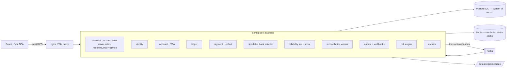

# Architecture

PaySure is a **modular monolith**: one deployable Spring Boot service whose packages are organised
by business capability. Each module has `api` (controllers + DTOs), `application` (services,
transaction boundaries), `domain` (entities, value objects, invariants) and `repository` layers.
Controllers are thin: they read the caller from the verified JWT, validate input and delegate.



`⟨Pn⟩` marks modules delivered in later phases; nothing in the diagram claims they exist yet.

## Package map (`com.paysure`)

| Package | Responsibility | Status |
|---|---|---|
| `identity` | registration, BCrypt hashing, login, JWT issue, `Caller` | Phase 1 ✅ |
| `account` | sandbox accounts, VPAs, ownership, activation, `AccountLocker` | Phase 1 ✅ |
| `ledger` | immutable double-entry journals; the only writer of balances | Phase 1 ✅ |
| `sandbox` | demo data seeder, ADMIN_DEMO dev tools (top-up) | Phase 1 ✅ |
| `config` | security, JWT keys, CORS, OpenAPI, typed properties | Phase 1 ✅ |
| `common` | RFC 7807 errors, request-id correlation, auditing base entity | Phase 1 ✅ |
| `payment` | payment engine: intake (idempotency + holds), finalizer (exactly-once), status verifier, state machine | Phase 2 ✅ |
| `collect` | request money: create / approve (pays once) / decline / cancel / expire | Phase 2 ✅ |
| `bank` | `BankGateway` / `BankCallbackListener` / `BankInspector` ports + `SimulatedBank` with its own tables and clock | Phase 2 ✅ |
| `reconciliation` | lease-based worker, run/item records, aggregate report, manual-review queue | Phase 3 ✅ |
| `reliability` | Reliability Lab (scenario catalogue, runs, timeline), explainable score + snapshots | Phase 3 ✅ |
| `events` | transactional outbox writer, ordered publisher (`EventPublisher` port + Kafka impl), topics, dead-letter handling | Phase 4 ✅ |
| `notification` | idempotent Kafka consumer (inbox), webhook endpoints, signed delivery worker with retries/DLQ, SSRF guard, sandbox receiver | Phase 4 ✅ |
| `ratelimit`, `cache` | atomic Redis rate limiting with in-memory fallback; read-through payment-status cache; Redis circuit breaker | Phase 4 ✅ |
| `risk` | rule-based risk engine (pure `RiskEngine`), fact gathering, alerts, review, `risk.alert` events | Phase 5 ✅ |
| `metrics` | System Monitoring summary/series (database + registry), dependency probes; Prometheus/Grafana config in `monitoring/` | Phase 5 ✅ |

## Request path and security

1. `RequestIdFilter` assigns/propagates `X-Request-Id` (MDC + echoed in error bodies).
2. Spring Security's OAuth2 resource server verifies the HS256 signature, expiry and issuer.
   The `roles` claim maps to `ROLE_USER` / `ROLE_ADMIN_DEMO`.
3. URL rules: `/api/auth/register|login`, health, OpenAPI are public; `/api/dev/**`, `/api/admin/**`
   and non-public actuator endpoints need `ADMIN_DEMO`; everything else needs authentication.
4. Services enforce **ownership** (`findByIdAndUserId`). Not-owned resources return 404.
5. All errors leave as `application/problem+json` with a stable `code`.

## Money-moving transaction (Phase 1: account funding / top-up)

```mermaid
sequenceDiagram
    participant C as AccountService
    participant L as LedgerService
    participant K as AccountLocker
    participant DB as PostgreSQL
    C->>DB: BEGIN
    C->>L: post(journal: DEBIT treasury, CREDIT account)
    L->>L: validate legs balanced, amounts > 0
    L->>DB: exists journal (type, reference)? → 409 if so
    L->>K: lockAll(accounts) in UUID order
    K->>DB: SELECT … FOR UPDATE (refresh)
    L->>L: Account.debit/credit (domain rules)
    L->>DB: INSERT journal, entries; UPDATE balances
    C->>DB: COMMIT → deferred trigger re-checks balance
```

## Payment transaction boundaries (Phase 2)

Two short database transactions with the bank call in between and **no lock held across the network
call**. Lock order everywhere: payment row → account rows (ascending id); intake locks only the payer
account and inserts a brand-new payment row, so no lock cycle exists. Details: [payments.md](payments.md).

## Reconciliation and lab (Phase 3)

The worker and the lab only use ports that already exist: `PaymentStatusVerifier` (query-only), `PaymentFinalizer`
(exactly-once) and `BankInspector`. Operator endpoints live under `/api/admin/**`. See [reconciliation.md](reconciliation.md).

## Events and Redis (Phase 4)

Business transactions write their events to the outbox in the same commit; Kafka, the webhook worker and Redis sit *behind* PostgreSQL and
can fail independently without affecting money. See [events.md](events.md), [webhooks.md](webhooks.md) and [redis.md](redis.md).

## Risk and monitoring (Phase 5)

The risk check runs in `PaymentIntake` after the idempotency key is claimed, so duplicates are evaluated once and the alert commits with the payment. Prometheus scrapes
`/actuator/prometheus`; Grafana is provisioned from `monitoring/`. See [risk.md](risk.md) and [monitoring.md](monitoring.md).
