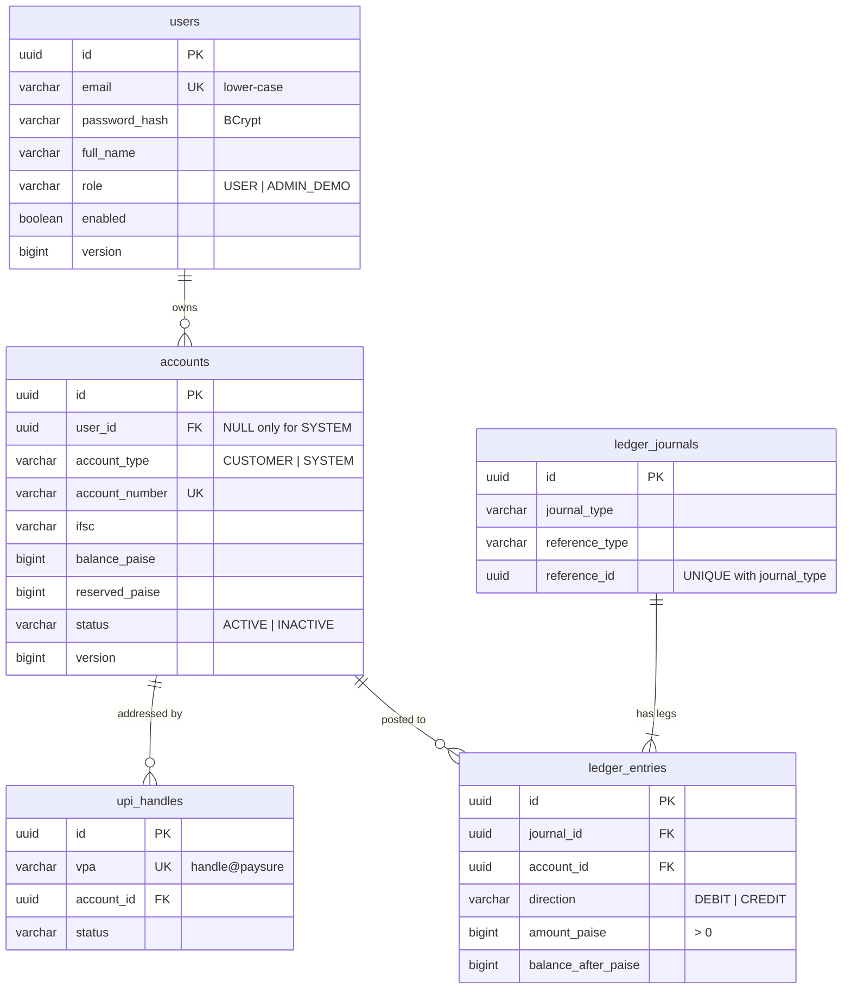
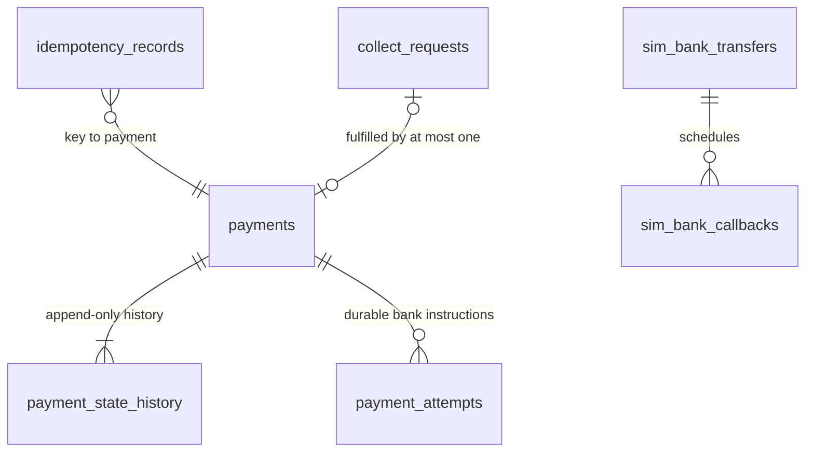

# Database design

PostgreSQL is the system of record. Flyway owns the schema (`backend/src/main/resources/db/migration`);
Hibernate runs with `ddl-auto: validate` and never changes it.

## Phase 1 — identity, accounts, ledger

| Table | Key constraints |
|---|---|
| `users` | `UNIQUE(email)`, `CHECK(email = lower(email))`, `CHECK(role IN …)` |
| `accounts` | `UNIQUE(account_number)`; owner rule (CUSTOMER ⇔ user_id NOT NULL); `CHECK(reserved_paise >= 0)`; customers: `balance_paise >= 0 AND reserved_paise <= balance_paise`; FK `ON DELETE RESTRICT` |
| `upi_handles` | `UNIQUE(vpa)`; regex `CHECK` on format; FK `ON DELETE RESTRICT` |
| `ledger_journals` | `UNIQUE(journal_type, reference_id)`; no UPDATE/DELETE (trigger) |
| `ledger_entries` | `CHECK(amount_paise > 0)`; no UPDATE/DELETE (trigger); deferred constraint trigger: each journal balances at COMMIT |

Seed row: `accounts.id = 00000000-0000-0000-0000-000000000001` — the SYSTEM **Sandbox Treasury**.

All mutable tables carry `version` (optimistic lock) and `created_at` / `updated_at` (`timestamptz`).

## Phase 2 — payments (`V3__payments.sql`)

`payment_attempts.bank_reference` matches `sim_bank_transfers.bank_reference` by value only — no FK,
because the simulated bank stands in for a separate system.

| Table | Key constraints |
|---|---|
| `payments` | `amount_paise > 0`; payer ≠ payee account; status/hold enums; `completed_at` set iff terminal; hold consistency: `CREATED⇒NONE`, `PROCESSING/PENDING⇒HELD`, `SUCCESS⇒CAPTURED`, `FAILED⇒NONE/RELEASED`; partial unique index: ≤ 1 payment per collect request |
| `payment_attempts` | `UNIQUE(bank_reference)`, `UNIQUE(payment_id, attempt_no)`; callback counters |
| `payment_state_history` | identity PK for ordering; UPDATE/DELETE rejected by trigger |
| `idempotency_records` | `UNIQUE(caller_user_id, idempotency_key)`; FK to payment `DEFERRABLE INITIALLY DEFERRED`; `expires_at` index |
| `collect_requests` | status enum; requester ≠ payer account; optional FK to the fulfilling payment |
| `sim_bank_transfers` | PK `bank_reference` (idempotent submit); `committed_status` kept separate from `response_kind` |
| `sim_bank_callbacks` | partial index on undelivered callbacks; delivery attempts + last error |
| `ledger_journals` | type CHECK extended with `PAYMENT_TRANSFER` |

Invariants asserted in SQL after every money-moving test: journals net to zero; balance = net ledger
movement; no customer below zero available; `reserved_paise` = sum of that payer's `HELD` payments;
exactly one `PAYMENT_TRANSFER` journal for each `SUCCESS` payment and none otherwise.

## Phase 3 — reconciliation, lab, score (`V4__reliability_lab_and_reconciliation.sql`)

| Table / change | Purpose and constraints |
|---|---|
| `payments` + `recon_lease_owner`, `recon_lease_until`, `recon_attempts`, `last_reconciled_at`, `needs_manual_review`, `manual_review_reason` | worker lease (claimed with `FOR UPDATE SKIP LOCKED`), attempt counting, one-time post-settlement check, review flag; partial indexes for in-flight and flagged payments |
| `idempotency_records` + `replay_count`, `last_replayed_at` | stored (not in-memory) duplicate-request counts for the score |
| `reconciliation_runs` | one row per run: trigger (`SCHEDULED/MANUAL/LAB`), status, counters, duration, avg/max recovery |
| `reconciliation_items` | one row per check: kind (`IN_FLIGHT/POST_SETTLEMENT/LEDGER`), status before/after, bank status, outcome CHECK, detail |
| `fault_scenarios` | the Lab catalogue (13 seeded rows) with CHECKs on delay/duplicates/requests |
| `lab_runs` | parameters, balances before / after fault, status after fault, score before |
| `reliability_snapshots` | stored score + components for the history chart |

## Phase 4 — events and webhooks (`V5__outbox_inbox_webhooks.sql`)

| Table | Purpose and constraints |
|---|---|
| `outbox_events` | `seq` identity (publication order), unique `id` (= event id), `payload` (the exact JSON sent), `status` `PENDING/PUBLISHED/DEAD`, attempts, last error; `published_at` set iff PUBLISHED; partial index on pending |
| `inbox_events` | `PRIMARY KEY (consumer, event_id)` — the consumer-side deduplication |
| `webhook_endpoints` | owner, URL (`^https?://`), event types, `enabled`, `secret_version` (**no secret column**: secrets are derived from a server key) |
| `webhook_deliveries` | `UNIQUE (endpoint_id, event_id)`; status `PENDING/DELIVERING/RETRYING/SUCCESS/DEAD`; attempts / max; `next_attempt_at`, `lease_until`; exact payload; `delivered_at` set iff SUCCESS |
| `webhook_delivery_attempts` | one row per attempt: number, start, duration, HTTP status, error, outcome |
| `webhook_receipts` | the sandbox receiver's log: `PRIMARY KEY (endpoint_id, event_id)`, call count, `processed_at` (set at most once) |

## Phase 5 — risk alerts (`V6__risk_alerts.sql`)

| Table / index | Purpose and constraints |
|---|---|
| `risk_alerts` | user, optional payment, VPAs, amount, score `0..100`, level `LOW/MEDIUM/HIGH`, action `ALLOW/REVIEW/BLOCK`, `blocked`, the rules that fired (JSON), explanation, suggested action, review status `OPEN/ACKNOWLEDGED/DISMISSED` (`reviewed_at` set iff reviewed); **a blocked attempt can never reference a payment** (CHECK) |
| `ix_payments_payer_payee_success` | partial index answering "has this payer ever completed a payment to this payee?" |

All planned tables now exist; the schema has 24 application tables across `V1`–`V6`, including every table the specification lists.

See [ADR 0001](adr/0001-ledger-and-reserved-funds.md) for the ledger and reserved-funds rationale.
