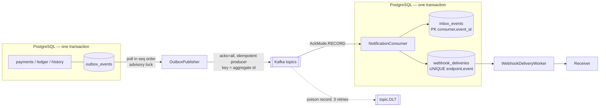

# Events: transactional outbox, Kafka, idempotent consumers (Phase 4)

> **Kafka is not what keeps money correct.** Money moves only inside PostgreSQL transactions (hold → capture → one ledger
> journal per payment, enforced by constraints). Kafka and Redis can be down, slow, duplicating or reordering messages and
> the ledger stays right. Events are how *other* systems (webhooks, later the risk engine) learn what already happened.
> PaySure does **not** claim end-to-end exactly-once money movement from Kafka; it gets *effectively-once effects* by
> combining at-least-once delivery with idempotent consumers.

## The pipeline

### 1. Database transaction + outbox (the producer side)

`PaymentIntake`, `PaymentFinalizer` and `ReconciliationWorker` call `OutboxService.record(...)` **inside** the transaction
that changes the business data. The method is `Propagation.MANDATORY` and uses the caller's JDBC connection, so the event
row and the business change commit — or roll back — together. There is no window where a payment is committed but its
event is lost, and no event for a payment that rolled back. (Tested: a rolled-back transaction leaves no outbox row.)

| Event | Written when | Topic |
|---|---|---|
| `payment.created` | intake transaction (also for payments refused immediately) | `paysure.payment.created` |
| `payment.completed` | finaliser transaction on SUCCESS (`resolvedBy`: bank response / callback / status check / reconciliation) | `paysure.payment.completed` |
| `payment.failed` | intake or finaliser transaction on FAILED | `paysure.payment.failed` |
| `reconciliation.completed` | same transaction as the run record, when a run did something | `paysure.reconciliation.completed` |
| `risk.alert` | Phase 5 (topic, consumer and webhook routing already exist) | `paysure.risk.alert` |

PENDING is deliberately **not** an event: it is not a final outcome.

### 2. Outbox publisher → Kafka

`OutboxPublisher` (every 500 ms) reads `PENDING` rows `ORDER BY seq` and publishes each to Kafka, waiting for the broker's
acknowledgement, then marks the row `PUBLISHED`.

- **At-least-once.** If the process dies after the broker acknowledged but before the row is marked, the row is published
  again. Consumers therefore must deduplicate (next section).
- **Ordering.** Rows are published strictly by `seq`. On a failure the batch **stops**, so no later event can overtake the failed
  one; the publisher then backs off exponentially (up to 30 s). The Kafka key is the aggregate id, so all events of one payment go
  to the same partition of their topic.
- **One active publisher.** A transaction-scoped PostgreSQL advisory lock (`pg_try_advisory_xact_lock`) makes several backend
  instances take turns instead of publishing the same rows concurrently (which could reorder them).
- **No poison pill.** After `paysure.events.max-attempts` (20) failures a row is marked `DEAD` (kept for inspection, counted by
  `outbox_dead_total`) so it cannot block everything behind it.
- Producer settings: `acks=all`, `enable.idempotence=true`, bounded `max.block.ms` / timeouts.
- `EventPublisher` is a port (`KafkaEventPublisher` by default); tests substitute a recording/failing one.

### 3. Consumer: offsets + inbox

`NotificationConsumer` (`@KafkaListener`, group `paysure-webhook-notifications`, `AckMode.RECORD`,
`enable.auto.commit=false`) calls `NotificationEventHandler.handle` which, in **one database transaction**:

1. inserts `(consumer, eventId)` into `inbox_events` (`ON CONFLICT DO NOTHING` — the primary key is the deduplication), and
2. inserts one `webhook_deliveries` row per matching endpoint (`UNIQUE(endpoint_id, event_id)`).

How the three mechanisms fit together:

| Situation | What happens |
|---|---|
| Handler succeeds, offset commit succeeds | normal |
| Handler's transaction fails | nothing is recorded; the offset is **not** committed; Kafka redelivers; the retry processes it |
| Handler committed, process dies before the offset commit | Kafka redelivers; the inbox row exists → logged as a duplicate and ignored |
| Producer retried / the outbox row was published twice | two identical records; the second hits the inbox and is ignored |
| Malformed record | the exception makes the container retry 3× (1 s apart), then publish it to `<topic>.DLT` and commit the offset, so one bad record cannot stall the partition |

Because the offset is committed only after the database transaction, and the database transaction is idempotent, the combined
result is **effectively-once creation of webhook deliveries** on top of at-least-once Kafka delivery.

> The DLT destination is configured explicitly (`<topic>.DLT`). The library default is `<topic>-dlt`; with broker topic
> auto-creation disabled (docker-compose) the default would have failed to publish. This was found by the Kafka integration test.

### 4. What is *not* guaranteed

- Delivery to external webhook receivers is at-least-once, never exactly-once; receivers must deduplicate by event id.
- Cross-partition or cross-topic ordering is not provided (per-aggregate ordering within a topic is).
- If Kafka is down for a long time, events accumulate in the outbox (visible at `/api/admin/events/outbox` and in the
  `outbox_pending` gauge) and flow once it returns. Payments are unaffected.

## Operating it

- Admin view: **Webhooks** page (operator panel) or `GET /api/admin/events/outbox` — pending / published / dead / inbox counts and the
  latest events with attempts and last error.
- Metrics: `outbox_published_total`, `outbox_publish_failures_total`, `outbox_dead_total`, `outbox_pending`,
  `events_duplicates_ignored_total`, `webhook_deliveries_enqueued_total`.
- Local no-Docker run: `./mvnw spring-boot:test-run` starts an in-process Kafka broker and a real `redis-server`.

## Testing (what actually ran)

Real PostgreSQL, a **real in-process Kafka broker** (spring-kafka-test) and a **real `redis-server`** process are used; no mocks of
the systems under test. Docker-based Testcontainers are used automatically when Docker is available (`-Dpaysure.test.db=testcontainers`
forces it); otherwise the embedded equivalents run. This machine has no Docker, so only the embedded path was executed here.
