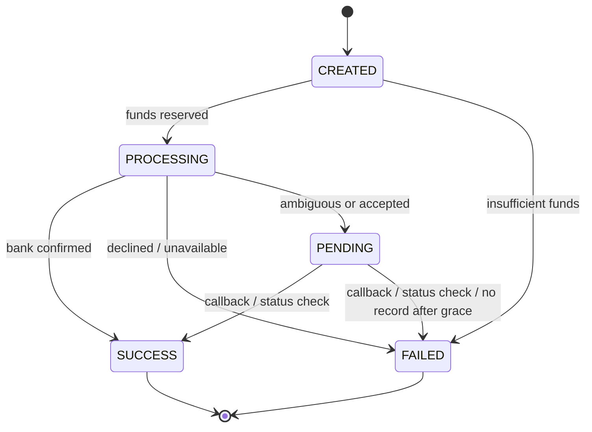

# Payment engine (Phase 2)

## Flow of `POST /api/payments`

| # | Step | Where | Transaction |
|---|---|---|---|
| 0 | Replay check: key already known? same hash → return it (200); different hash → 409 | `PaymentService` | read |
| 1–6 | Authenticate (JWT), validate amount (1…₹1,00,000), parse VPAs, payer VPA must be the caller's (403), payee must be active (404), no same-account transfer (422), fault injection only for ADMIN_DEMO (403) | `PaymentService.validate` | read |
| 7 | **Claim** `(caller, Idempotency-Key)` with `INSERT … ON CONFLICT DO NOTHING` | `PaymentIntake` | **T1** |
| 8 | Persist payment `CREATED` + history row | `PaymentIntake` | T1 |
| 9 | Lock payer account (`FOR UPDATE`), check available funds; **reserve** them (or → `FAILED INSUFFICIENT_FUNDS`) | `PaymentIntake` | T1 |
| 10 | Write the durable instruction (`payment_attempts`, unique `bank_reference`); → `PROCESSING` | `PaymentIntake` | T1 commit |
| 11 | Call the bank. **No DB transaction or lock is open.** Any exception = ambiguous | `PaymentService` | none |
| 12–15 | Record the response; SUCCESS → post ledger + capture hold; DECLINED/UNAVAILABLE → release hold, `FAILED`; ACCEPTED/TIMEOUT/NETWORK_ERROR → `PENDING` | `PaymentFinalizer` | **T2** |
| 16 | Return the payment: 201 (new) or 200 + `Idempotent-Replayed: true` | `PaymentController` | — |

Event publishing through a transactional outbox arrives in Phase 4; it will be written inside T1/T2.

## State machine

- Defined once in `PaymentStateMachine`; `Payment.transition` is the only way to change status.
- Terminal states have no exits, so `SUCCESS → FAILED`, `SUCCESS → PENDING` etc. are impossible.
- Every transition appends to `payment_state_history` (append-only, DB trigger) with source and reason.
- Hold bookkeeping is checked both in Java and by DB `CHECK` constraints
  (e.g. `SUCCESS ⇒ hold CAPTURED`, `PENDING ⇒ hold HELD`).
- All signals for one payment are serialised by `SELECT … FOR UPDATE` on the payment row (+ `@Version`).

## Exactly-once finalisation — three independent guards

1. **State machine**: a terminal payment ignores further outcomes (`NO_CHANGE`), or reports `CONFLICT`
   if the bank contradicts it (logged for manual review; nothing changes).
2. **Callback sequence numbers**: only a strictly newer sequence is applied; duplicates and stale
   out-of-order callbacks are counted and ignored.
3. **Ledger uniqueness**: `UNIQUE (journal_type, reference_id)` — at most one `PAYMENT_TRANSFER` per payment.

## Idempotency

- Key: 8–100 chars `[A-Za-z0-9._:-]`, sent as the `Idempotency-Key` header. Required.
- Scope: per authenticated caller (two users may use the same key independently).
- Request hash: SHA-256 over a versioned canonical form (normalised VPAs, amount, trimmed note, simulation options).
- The key, hash and payment id are committed **in the same transaction** as the payment, so a key can
  never exist without its payment (the FK is `DEFERRABLE INITIALLY DEFERRED`).
- Concurrency: a second claimer of the same key blocks on the unique index until the first commits,
  then sees the existing row and replays it. Verified with 10 concurrent identical requests.
- The processing/result state of a key is the linked payment's status (single source of truth).
- **Retention**: at least 24 h (`paysure.payments.idempotency-ttl`). The cleanup job deletes expired
  keys **only if their payment is terminal** — a key is never forgotten while its outcome is unknown.
  After deletion the same key may create a new payment.

## Simulated bank

`BankGateway` (submit, queryStatus) and `BankCallbackListener` are the ports; `SimulatedBank` is the
in-process implementation with its own tables (`sim_bank_transfers`, `sim_bank_callbacks`). It records
what it **committed** separately from what it **told** PaySure. Submitting a reference twice never
commits twice; `queryStatus` never initiates a transfer.

| Scenario | Bank commits | PaySure hears | Resolves via |
|---|---|---|---|
| `NORMAL_SUCCESS` | SUCCESS | SUCCESS | immediately |
| `INSUFFICIENT_FUNDS` | FAILED | DECLINED | immediately |
| `BANK_TIMEOUT` | FAILED (never debited) | TIMEOUT → PENDING | status check → FAILED |
| `TIMEOUT_AFTER_COMMIT` | SUCCESS | TIMEOUT → PENDING | status check → SUCCESS |
| `BANK_UNAVAILABLE` | nothing | UNAVAILABLE | immediately FAILED |
| `NETWORK_FAILURE` | nothing | NETWORK_ERROR → PENDING | status check: NOT_FOUND → FAILED after grace |
| `DELAYED_SUCCESS` / `DELAYED_FAILURE` | after delay | ACCEPTED → PENDING | callback |
| `DUPLICATE_CALLBACK` | SUCCESS after delay | ACCEPTED → PENDING | N identical callbacks, applied once |
| `OUT_OF_ORDER_CALLBACK` | SUCCESS after delay | ACCEPTED → PENDING | seq 2 SUCCESS, then stale seq 1 ignored |

- A background clock (`SimulatedBankScheduler`, 1 s) resolves delayed transfers and delivers callbacks
  at-least-once with exponential backoff on failure. Demo admins can fast-forward it:
  `POST /api/dev/bank/tick?skipAheadSeconds=600`.
- **Seeded mode**: `PAYSURE_BANK_CHAOS_ENABLED=true` injects faults into requests without an explicit
  scenario, drawn from `Random(seed)`; `POST /api/dev/bank/chaos/reset?seed=42` replays the same sequence.
- Only ADMIN_DEMO users may choose a scenario per payment.

## Collect requests (request money)

`PENDING → APPROVED | DECLINED | CANCELLED | EXPIRED` (lazy expiry, default 24 h, max 7 days).
Only the payer approves/declines; only the requester cancels. Approval locks the request row, marks it
APPROVED, then pays through the normal engine with the deterministic key `collect:<requestId>`, and a
unique index allows at most one payment per request. Re-approving (or approving concurrently) returns
the same payment; a crash between approval and payment is completed by approving again.
If that payment fails (e.g. insufficient funds), the request stays APPROVED with a FAILED payment —
the requester must raise a new request.

## Metrics (Prometheus)

`payment_requests_total`, `payment_success_total`, `payment_failure_total`, `payment_pending_total`,
`duplicate_requests_prevented_total`, `bank_callbacks_ignored_total`, `payment_processing_duration_seconds`.
No user/payment/reference labels.
