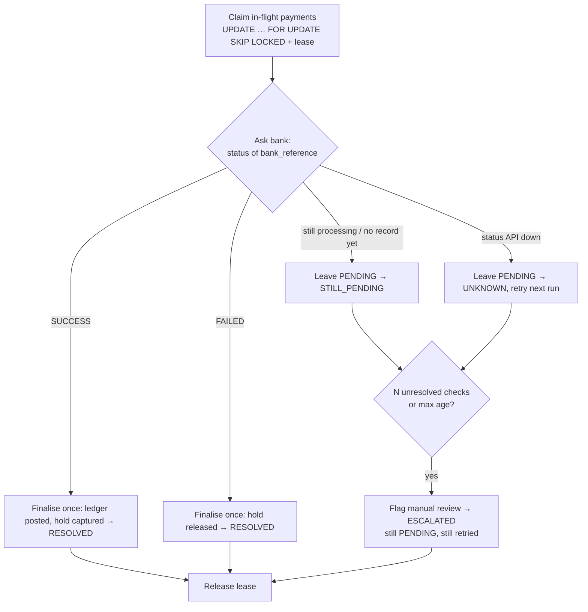

# Reconciliation, Reliability Lab and Reliability Score (Phase 3)

## Self-healing reconciliation

`ReconciliationWorker` runs every 15 s (`paysure.reconciliation.*`) and on demand
(`POST /api/admin/reconciliation/run`). It never moves money itself: it only **asks the bank what happened** by the
stable `bank_reference` and applies the answer through the same exactly-once `PaymentFinalizer` used by callbacks.

| Requirement | How it is met |
|---|---|
| Find eligible pending payments | `status IN (PROCESSING, PENDING)` unfinished for ≥ `min-age` (10 s), oldest first, batch of 50 |
| Claim safely | lease columns on `payments` set by one `UPDATE … WHERE id IN (SELECT … FOR UPDATE SKIP LOCKED) RETURNING id`; a live lease keeps other workers away, an expired lease (crashed worker) is reclaimed |
| Query by stable reference | `PaymentStatusVerifier` → `BankGateway.queryStatus(bank_reference)`; there is no code path from the worker to `submit` |
| Compare internal vs bank state | in-flight: bank answer vs local status; **finished payments are cross-checked once** against the bank's record; ledger/hold invariants are checked every run |
| Finalise idempotently | state machine + callback sequence + one-ledger-journal-per-payment (see [payments.md](payments.md)) |
| Leave unknown pending | `STILL_PENDING` / `UNKNOWN` change nothing |
| Escalate | after `escalate-after-attempts` (5) unresolved checks or `escalate-after-age` (10 m): `needs_manual_review` + reason; recorded once as `ESCALATED` |
| Record attempts | `reconciliation_runs` (counters, duration, recovery times) and `reconciliation_items` (one row per check with before/after status, bank status, outcome, detail) |
| Publish an event when resolved | **not yet** — the transactional outbox is Phase 4. Resolutions are logged and counted (`reconciliation_resolved_total`) |

A bank answer of `NOT_FOUND` is treated as "nothing happened" only after `paysure.payments.not-found-grace` (30 s);
before that it is `STILL_PENDING`. A bank that **contradicts a finished payment** (local SUCCESS vs bank FAILED, or the
reverse) is reported as `CONFLICT`, flagged for manual review and **never auto-corrected**.

### Report (`GET /api/admin/reconciliation/report?hours=24`)

Total checked · resolved (success / failed) · still pending now · unknown outcomes seen · escalated · conflicting
payments · ledger inconsistencies (latest run) · average and maximum recovery time (payment created → resolved) ·
manual-review cases. Also `/runs`, `/runs/{id}/items`, `/manual-review`. UI: **Reconciliation** page (demo admin).

### Ledger inconsistency checks (every run)

Journals that do not net to zero · account balance ≠ net ledger movement · reserved funds ≠ sum of held payments ·
payment with ≠ 1 transfer journal iff SUCCESS. The first three are also blocked by DB constraints; the check detects
anything that bypassed the application.

## Reliability Lab

`/api/admin/lab/*` (ADMIN_DEMO). A scenario from the `fault_scenarios` table is applied as options on the **simulated**
bank for a sandbox payment between sandbox accounts, through the normal payment code path.

| Code | Category | Bank does | Outcome / recovery |
|---|---|---|---|
| `HAPPY_PATH` | baseline | commits, confirms | SUCCESS |
| `LOST_ACKNOWLEDGEMENT` | ambiguous | commits, reply lost | PENDING → reconciliation → SUCCESS, one posting |
| `BANK_TIMEOUT` | ambiguous | never executes, no reply | PENDING → FAILED, hold released |
| `NETWORK_DROP` | ambiguous | never receives | PENDING → FAILED after grace |
| `BANK_DOWN`, `REMITTER_DECLINE` | definitive | refuses / declines | FAILED at once |
| `DELAYED_CONFIRMATION`, `DELAYED_DECLINE` | async | confirms/declines later by callback | PENDING → callback |
| `DUPLICATE_CALLBACKS`, `OUT_OF_ORDER_CALLBACKS` | duplicates | repeats / reorders callbacks | applied once, extras ignored |
| `DUPLICATE_SUBMISSIONS` | duplicates | — (10 identical client requests) | 1 payment, 1 transfer |
| `STUCK_AT_BANK` | escalation | processing for a long time | stays PENDING → escalated → SUCCESS when bank finishes |
| `STATUS_API_OUTAGE` | escalation | commits, reply lost, **status API down** | UNKNOWN until the API is restored |

Flow: choose scenario (+ amount, delay, duplicate callbacks) → **Start simulation** → observe the event timeline (client,
PaySure, bank, reconciler), the bank's committed-vs-reported view, ledger, balances before / after fault / now and the
score before → now → use **Run reconciliation**, **Fast-forward bank clock** or **Restore bank status API** → read the
generated "what happened, and why". The background reconciler may also heal the run by itself (the page refreshes every 3 s).

Safety: only ADMIN_DEMO; amount ≤ ₹5,000; faults exist only as simulated-bank options; the status-API switch is global to
the simulator and is reset by any lab run that does not need it down.

## Reliability score

`GET /api/admin/reliability?windowMinutes=60`, history from stored snapshots (`reliability_snapshots`, taken every 5 min
and around each lab step). **A configurable demo score, not an industry benchmark.** Every input comes from stored rows.

`score = round( Σ weight × component ÷ Σ weight )` over components **that have data** (others are excluded, never scored 100).

| Component (default weight) | Measured from | Component score |
|---|---|---|
| Confirmed success rate (30) | finished payments that reached the bank | `100 × SUCCESS / finished` |
| Pending age (15) | oldest unresolved payment | `100 × (1 − min(1, age / 900 s))` |
| Median / P95 completion latency (10) | created → completed of SUCCESS payments | 100 at P95 ≤ 2 s, 0 at ≥ 60 s |
| Timeout rate (10) | attempts answered TIMEOUT / NETWORK_ERROR | `100 × (1 − min(1, rate / 25 %))` |
| Reconciliation recovery rate (15) | payments that went PENDING and are now final | `100 × recovered / entered` |
| Duplicate-processing prevention (10) | SUCCESS payments without exactly one ledger posting (+ duplicates absorbed, shown for context) | `100 × (1 − violations / SUCCESS)` |
| Webhook delivery success (10) | **not measurable until Phase 4** | excluded |

Example from the tests: three clean payments → 100; one lost acknowledgement → 72 (timeout rate 25 %, recovery 0 %);
after reconciliation → 89 (recovery 100 %, but the timeout still happened). Weights and budgets: `paysure.reliability.*`.

## Metrics added

`reconciliation_runs_total`, `reconciliation_resolved_total` (no per-payment labels).
